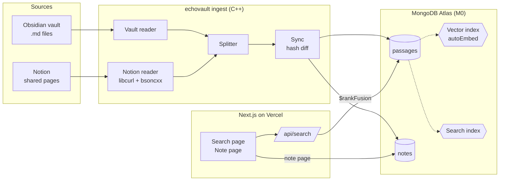

# echoVault — Architecture

How notes get from Obsidian and Notion into Atlas, and how a search finds them. Terms (Source, Note, Location, Passage) are defined in [`GLOSSARY.md`](../GLOSSARY.md); decisions and budget live in [`PLAN.md`](./PLAN.md).

## Overview



Three parts, each with one job:

| Part | Job | Talks to |
|---|---|---|
| **Ingest CLI** (`ingest/`) | Read Notes from a Source, split them into Passages, sync them to Atlas | Filesystem, Notion API, Atlas (read/write user) |
| **Atlas** | Store Passages, embed them, serve keyword + vector search | — |
| **Web app** (`web/`) | Take a query, run hybrid search, show Passages with citations | Atlas (read-only user) |

## Ingest

```
echovault ingest obsidian <vault-path> --name <source-name>
echovault ingest notion --name <source-name>      # token from NOTION_TOKEN
```

### Readers

Both readers produce the same thing: a Note as a list of markdown-style lines plus its metadata. Everything after this point is source-agnostic.

- **Vault reader:** walks the folder, skips `.obsidian/` and non-`.md` files. Note ID = path relative to the vault root. Location = the folder part of that path.
- **Notion reader:** starts from the pages shared with the integration, walks child pages and database rows. Note ID = page ID. Location = titles of parent pages, recomputed every run. Converts blocks to lines (`heading_2` → `## …`, `paragraph` → text, `code` → fenced block, and so on). Database row properties are ignored. Respects Notion's ~3 req/s limit.

### Splitter

Input: a Note's lines. Output: Passages, each with text, heading path, and line range.

1. Strip the frontmatter block (`---` … `---` at the top); keep its `tags`.
2. Walk lines, tracking code fences. A `#` line outside a fence starts a new section; heading path is the stack of enclosing headings.
3. A section over ~400 tokens is split again at blank lines (paragraph breaks). A Note with no headings is one section, split the same way.
4. Clean text: `[[Target|alias]]` → `alias`, `[[Target]]` → `Target`; drop `![[embeds]]` and images.

The splitter is pure (lines in, Passages out) so it is unit-tested without a database.

### Sync

Passage identity is a content hash, so sync is set arithmetic. Per Source:

1. For each Note: hash each Passage (`sha256(headingPath + text)`), load the existing hashes for that Note, **insert** new hashes, **delete** missing ones. Unchanged Passages are untouched and never re-embedded.
2. Upsert the Note's row in `notes`.
3. Delete Passages and `notes` rows for Notes no longer present in the Source.

For Notion, step 1 is skipped entirely for pages whose `last_edited_time` matches the one stored in `notes`. Obsidian has no such shortcut in v1; reading local files is cheap and the hash diff does the work.

## Data model

### `passages`

```js
{
  _id: ObjectId,
  source: { kind: "obsidian" | "notion", name: "demo-vault" },
  noteId: "Classes/Biology/Cell respiration.md",   // or a Notion page ID
  noteTitle: "Cell respiration",
  location: ["Classes", "Biology"],                // folders, or parent page titles
  headingPath: ["Krebs cycle", "Inputs"],          // empty if none
  lines: { start: 14, end: 22 },                   // Obsidian only
  blockId: "…",                                    // Notion only: first block of the Passage
  text: "…verbatim passage…",                      // embedded by autoEmbed
  hash: "sha256…",
  tags: ["bio101"],
  mtime: ISODate
}
```

Unique index on `{ "source.name": 1, noteId: 1, hash: 1 }`.

### `notes`

One row per Note. Backs the read-only note page and the Notion skip check.

```js
{
  _id: "<source.name>:<noteId>",
  source: { kind, name },
  noteId, title, location,
  url: "obsidian://…" | "https://www.notion.so/…",
  lastEdited: ISODate,        // Notion last_edited_time, or file mtime
  text: "…full cleaned note…" // for the note page
}
```

## Search

### Indexes (2 of M0's 3)

- **Vector index** on `passages.text` with Automated Embedding (Voyage). Atlas embeds Passages on write and the query text at search time, so no embedding key lives in the web app.
- **Search index** on `text`, `noteTitle`, `headingPath` (standard analyzer), with highlighting on `text`.

Index definitions are checked in under `docs/indexes/*.json`.

### Query

`POST /api/search { q }`. `q` is capped at 200 characters.

```js
[
  { $rankFusion: {
      input: { pipelines: {
        vector:  [{ $vectorSearch: { index: "passages_vector", path: "text", query: q, numCandidates: 100, limit: 20 } }],
        keyword: [{ $search: { index: "passages_text", text: { query: q, path: ["text", "noteTitle", "headingPath"] } } }, { $limit: 20 }]
      } }
  } },
  { $limit: 10 },
  { $project: { text: 1, source: 1, noteId: 1, noteTitle: 1, location: 1, headingPath: 1, lines: 1 } }
]
```

If `$rankFusion` isn't available on M0, the fallback is both pipelines joined with `$unionWith`, each assigned `1 / (60 + rank)`, then grouped by `_id` and summed (reciprocal rank fusion by hand). The first 2 hours of the build confirm which path applies.

The same endpoint can run `vector` or `keyword` alone, which is how the eval compares the three modes.

## Web

- **Search page:** query box, 6 pinned example queries, result cards. Each card shows the verbatim Passage and its citation: **Source › Location › Note › heading › lines**. Notion has no real lines, so Notion citations stop at the heading and link to `notion.so/<page>#<blockId>`.
- **Note page** (`/note/[id]`): the full Note from `notes`, with the Passage's lines highlighted. This is where demo result cards link.
- **Links:** on the demo, a card opens the note page. Running locally against the `personal` project, cards link out to `obsidian://open?vault=…&file=…` or the Notion page URL. The mode comes from an env var.

## Deployment and security

| | `demo` project | `personal` project |
|---|---|---|
| Notes | Fictional sample vault + sample Notion workspace | My real vault + Notion |
| Ingest | Run locally, read/write user | Run locally, read/write user |
| Web app | Vercel, **read-only** user | `npm run dev` on my machine only |
| Public? | Yes | Never |

- Vercel's built-in rate limiting protects `/api/search`. The DB user it holds can't write anything.
- Secrets (`MONGODB_URI`, `NOTION_TOKEN`) live in `.env` (git-ignored) and Vercel env vars.

## Known limits

- **Identical paragraphs in one Note.** Two Passages with the same heading path and text hash the same and collapse into one. Accepted for v1; revisit if it shows up.
